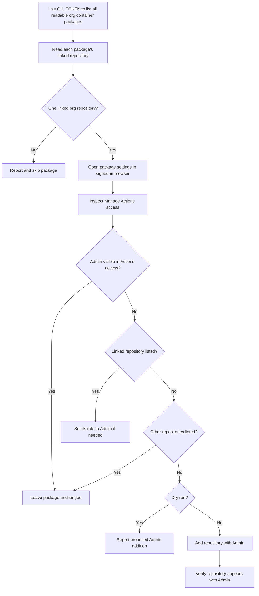

# GitHub Packages Inheritance

This utility lists an organization's Container Registry packages through GitHub's authenticated REST API, then uses GitHub's web UI to inspect each package's **Manage Actions access**. It skips packages where Admin is already visible in that section; otherwise it sets the linked repository's existing access to Admin, or adds it with Admin when no repository is listed. This can help packages published with an organization-wide token be republished by workflows using the repository's standard `GITHUB_TOKEN`.

The utility currently supports GitHub.com container packages. `GH_TOKEN` authenticates package listing through the API. A separate persistent local Chromium profile is used for package settings; sign in through GitHub's normal browser flow if prompted. The token is read from `.env` or the shell environment and is never printed. It does not authenticate the browser session.

## Safety and behavior

- The API listing follows pagination and returns packages readable by `GH_TOKEN`.
- `--dry-run` inspects **Manage Actions access** and reports proposed additions without changing settings.
- `--apply` explicitly enables changes and overrides `DRY_RUN`.
- If neither is supplied, changes are applied unless `DRY_RUN` is set to a true value.
- A package is skipped if it has no linked organization repository or the Actions-access section cannot be identified.
- If the word Admin is visible anywhere in **Manage Actions access**, the package is left unchanged, even if it belongs to a different repository. Hidden menu options and other settings sections do not count.
- Otherwise, if the linked repository is already listed, the script changes its role to Admin. If only other repositories are listed, the package is left unchanged.
- Adding a repository and setting Admin are separate UI steps. The script reloads the package settings to verify Admin. If adding succeeds but Admin cannot be confirmed, it reports a partial change; inspect the role or rerun to retry the linked repository.
- Admin grants broad package access. Review the dry-run output and ensure the signed-in browser account is authorized before applying changes.

## Workflow



## Requirements

- Python 3.9 or later
- A GitHub personal access token (classic) with `read:packages` and access to the organization
- A GitHub browser account with permission to manage package Actions access
- Chromium installed for Playwright

## Setup

From this directory, create and activate a virtual environment, then install the dependencies and browser:

```sh
python3 -m venv .venv
source .venv/bin/activate
python -m pip install -r requirements.txt
python -m playwright install chromium
```

Copy the tracked template to the ignored `.env` file and edit it:

```sh
cp env.example .env
```

The script loads `.env` automatically from its own directory. The example sets `DRY_RUN=true`; keep it enabled while checking the detected packages and repositories. Set `DRY_RUN=false` or pass `--apply` when ready to make changes.

## Configuration

| Setting | CLI option | Environment variable | Default |
| --- | --- | --- | --- |
| Organization | `--org` | `ORG` | Required |
| GitHub API token | None | `GH_TOKEN` | Required; classic PAT with `read:packages` |
| Persistent browser profile directory | `--profile-dir` | `DIR` | `~/.cache/github-packages-inheritance` |
| Non-mutating mode | `--dry-run` / `--apply` | `DRY_RUN` | Apply changes unless true |
| Environment file | `--env-file` | N/A | `.env` beside the script |

Configuration precedence is CLI option, then shell environment, then `.env` file. Use `--env-file` to load a different file. `DRY_RUN` accepts `true`/`false`, `1`/`0`, `yes`/`no`, and `on`/`off` (case-insensitive). `--dry-run` and `--apply` are mutually exclusive.

## Usage

Preview changes using the environment:

```sh
python packages_inheritance.py --dry-run
```

Each planned change identifies the repository, role, and package settings URL:

```text
Would add my-org/my-repo to Actions access with Admin: https://github.com/orgs/my-org/packages/container/my-package/settings
```

The preview reports role changes for linked repositories already listed with Read or Write access when no Admin is visible in the section. Packages with Admin visible or only other repositories listed are reported as unchanged. Skipped packages and their reasons are printed to standard error. Dry run does not submit changes or verify that GitHub will accept them during apply; review both the preview and any skipped-package errors.

Or provide settings directly:

```sh
python packages_inheritance.py --org my-org --profile-dir "$HOME/.cache/github-packages-inheritance" --dry-run
```

Load a non-default configuration file:

```sh
python packages_inheritance.py --env-file ./staging.env --dry-run
```

Apply changes after reviewing the preview:

```sh
python packages_inheritance.py --org my-org --apply
```

Before processing packages, the script opens GitHub's sign-in page in Chromium and waits for you to press Enter in the terminal. Sign in in that window, complete any organization SSO, or confirm the existing session is using the correct account before continuing. The profile is reused on later runs. `GH_TOKEN` authenticates the API listing only and cannot sign the browser in. Do not share the profile directory because it contains browser session data.

## Container image

The `Publish packages-inheritance container` workflow builds and publishes the image to `ghcr.io/renan-alm/packages-inheritance` when changes under this project are pushed to `main`. It can also be started manually from the Actions tab. The default-branch image is tagged `latest`; each build also receives a commit SHA tag.

The image includes Python dependencies and Chromium. It does not include `.env` or browser session data. On the other computer, copy `env.example` to `.env`, add your `GH_TOKEN`, and authenticate to GHCR if the package is private:

```sh
docker login ghcr.io -u renan-alm
docker pull ghcr.io/renan-alm/packages-inheritance:latest
```

Run the container with your environment file, a persistent profile directory, and access to a graphical display. Example for a Linux host using X11:

```sh
docker run --rm -it \
	--env-file .env \
	--env DIR=/data/browser-profile \
	--env DISPLAY="$DISPLAY" \
	--volume "$PWD/browser-profile:/data/browser-profile" \
	--volume /tmp/.X11-unix:/tmp/.X11-unix \
	ghcr.io/renan-alm/packages-inheritance:latest --dry-run
```

The container needs a display because Chromium opens GitHub's UI for SSO and Actions-access management. Sign in in that browser window, then press Enter in the terminal to continue; the mounted profile keeps the session for later runs. Keep `-it` so the script can receive your confirmation. macOS and Windows require a host display bridge (for example, XQuartz on macOS); the Linux X11 command above is not sufficient for them. `GH_TOKEN` authenticates package listing only, not the browser session.

Review the dry-run output, then replace `--dry-run` with `--apply` to make changes.

## Tests

Run the local tests without connecting to GitHub:

```sh
python -m unittest discover -s . -p 'test_*.py' -v
```

Live UI behavior should first be checked with `--dry-run` against an organization where you have permission to view its packages.