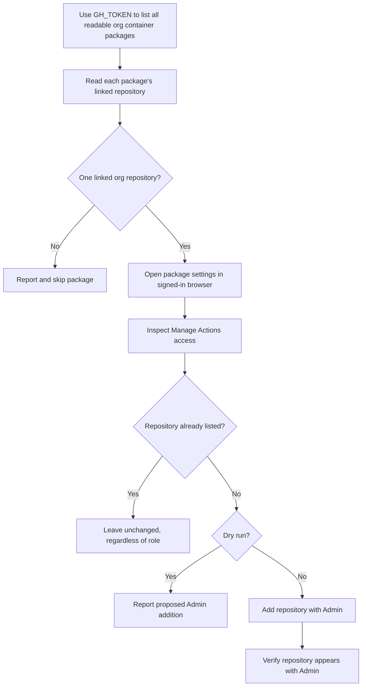

# GitHub Packages Inheritance

This utility lists an organization's Container Registry packages through GitHub's authenticated REST API, then uses GitHub's web UI to inspect each package's **Manage Actions access**. If the package's linked repository is not already listed there, the utility can add it with the Admin role. This can help packages published with an organization-wide token be republished by workflows using the repository's standard `GITHUB_TOKEN`.

The utility currently supports GitHub.com container packages. `GH_TOKEN` authenticates package listing through the API. A separate persistent local Chromium profile is used for package settings; sign in through GitHub's normal browser flow if prompted. The token is read from `.env` or the shell environment and is never printed. It does not authenticate the browser session.

## Safety and behavior

- The API listing follows pagination and returns packages readable by `GH_TOKEN`.
- `--dry-run` inspects **Manage Actions access** and reports proposed additions without changing settings.
- `--apply` explicitly enables changes and overrides `DRY_RUN`.
- If neither is supplied, changes are applied unless `DRY_RUN` is set to a true value.
- A package is skipped if it has no linked organization repository or the Actions-access section cannot be identified.
- If that repository is already listed under **Manage Actions access**, it is left unchanged regardless of its current role. Only missing repositories are added, with Admin.
- Admin grants broad package access. Review the dry-run output and ensure the signed-in browser account is authorized before applying changes.

## Workflow



## Requirements

- Python 3.9 or later
- A GitHub personal access token (classic) with `read:packages` and access to the organization
- A GitHub browser account with permission to manage package Actions access
- Chromium installed for Playwright

## Setup

From this directory, create and activate a virtual environment, then install the dependencies and browser:

```sh
python3 -m venv .venv
source .venv/bin/activate
python -m pip install -r requirements.txt
python -m playwright install chromium
```

Copy the tracked template to the ignored `.env` file and edit it:

```sh
cp env.example .env
```

The script loads `.env` automatically from its own directory. The example sets `DRY_RUN=true`; keep it enabled while checking the detected packages and repositories. Set `DRY_RUN=false` or pass `--apply` when ready to make changes.

## Configuration

| Setting | CLI option | Environment variable | Default |
| --- | --- | --- | --- |
| Organization | `--org` | `ORG` | Required |
| GitHub API token | None | `GH_TOKEN` | Required; classic PAT with `read:packages` |
| Persistent browser profile directory | `--profile-dir` | `DIR` | `~/.cache/github-packages-inheritance` |
| Non-mutating mode | `--dry-run` / `--apply` | `DRY_RUN` | Apply changes unless true |
| Environment file | `--env-file` | N/A | `.env` beside the script |

Configuration precedence is CLI option, then shell environment, then `.env` file. Use `--env-file` to load a different file. `DRY_RUN` accepts `true`/`false`, `1`/`0`, `yes`/`no`, and `on`/`off` (case-insensitive). `--dry-run` and `--apply` are mutually exclusive.

## Usage

Preview changes using the environment:

```sh
python packages_inheritance.py --dry-run
```

Or provide settings directly:

```sh
python packages_inheritance.py --org my-org --profile-dir "$HOME/.cache/github-packages-inheritance" --dry-run
```

Load a non-default configuration file:

```sh
python packages_inheritance.py --env-file ./staging.env --dry-run
```

Apply changes after reviewing the preview:

```sh
python packages_inheritance.py --org my-org --apply
```

The first run opens Chromium. Sign in to GitHub in that window if prompted; the profile is reused on later runs. `GH_TOKEN` authenticates the API listing only and cannot sign the browser in. Do not share the profile directory because it contains browser session data.

## Tests

Run the local tests without connecting to GitHub:

```sh
python -m unittest discover -s . -p 'test_*.py' -v
```

Live UI behavior should first be checked with `--dry-run` against an organization where you have permission to view its packages.